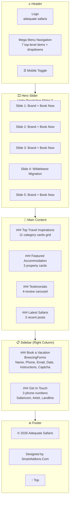
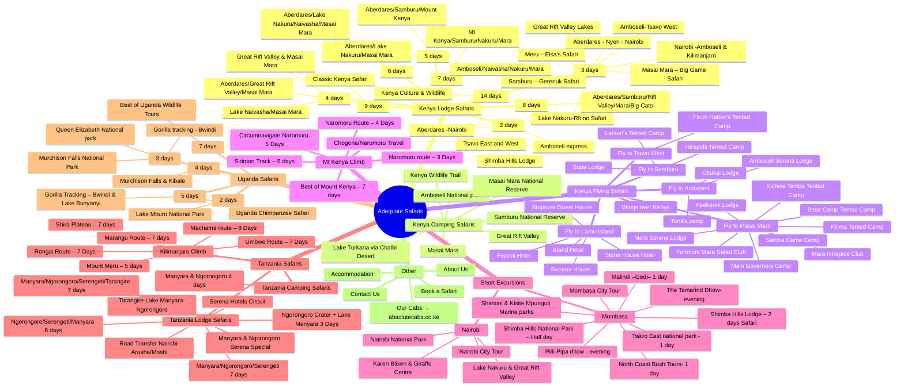

# Visual Sitemap — Adequate Safaris (Current)

```mermaid
flowchart TD
    Home[🏠 Home<br/>SP PageBuilder Landing]
    
    Home --> About[📖 About Us]
    Home --> Accommodation[🏨 Accommodation]
    Home --> Cabs[🚗 Our Cabs<br/>external: absolutecabs.co.ke]
    Home --> Book[📝 Book a Safari<br/>BreezingForms]
    Home --> Contact[📞 Contact Us]

    %% Kenya Lodge Safaris
    Home --> KLS[🦁 Kenya Lodge Safaris]
    KLS --> KL2[2 Days<br/>4 tours]
    KLS --> KL3[3 Days<br/>8 tours]
    KLS --> KL4[4 Days<br/>3 tours]
    KLS --> KL5[5 Days<br/>2 tours]
    KLS --> KL6[6 Days<br/>1 tour]
    KLS --> KL7[7 Days<br/>2 tours]
    KLS --> KL8[8 Days<br/>1 tour]
    KLS --> KL9[9 Days<br/>1 tour]
    KLS --> KL14[14 Days<br/>1 tour]

    %% Kenya Camping
    Home --> KCS[🏕️ Kenya Camping Safaris<br/>7 tours]

    %% Kenya Flying
    Home --> KFS[✈️ Kenya Flying Safaris]
    KFS --> KFSLamu[Fly to Lamu Island<br/>5 hotels]
    KFS --> KFSMara[Fly to Masai Mara<br/>9 camps/lodges]
    KFS --> KFSWings[Wings over Kenya<br/>1 tour]
    KFS --> KFSSamburu[Fly to Samburu<br/>3 camps]
    KFS --> KFSAmboseli[Fly to Amboseli<br/>3 lodges]
    KFS --> KFSTsavo[Fly to Tsavo West<br/>1 camp]

    %% Mt Kenya
    Home --> MKC[⛰️ Mt Kenya Climb<br/>6 routes]

    %% Short Excursions
    Home --> SE[🚶 Short Excursions]
    SE --> SEN[📍 Nairobi<br/>4 excursions]
    SE --> SEM[📍 Mombasa<br/>9 excursions]

    %% Tanzania
    Home --> TZ[🇹🇿 Tanzania Safaris]
    TZ --> TZL[Lodge Safaris<br/>8 tours]
    TZ --> TZC[Camping Safaris<br/>1 tour]
    TZ --> TZK[Kilimanjaro Climb<br/>6 routes]

    %% Uganda
    Home --> UG[🇺🇬 Uganda Safaris]
    UG --> UG2[2 Days<br/>1 tour]
    UG --> UG3[3 Days<br/>3 tours]
    UG --> UG4[4 Days<br/>1 tour]
    UG --> UG5[5 Days<br/>2 tours]
    UG --> UG7[7 Days<br/>1 tour]

    %% Styling
    classDef home fill:#1e3a5f,color:#fff,stroke:#3498db,stroke-width:3px;
    classDef country fill:#27ae60,color:#fff,stroke:#2ecc71,stroke-width:2px;
    classDef subcat fill:#2c3e50,color:#fff,stroke:#34495e,stroke-width:1px;
    classDef external fill:#e67e22,color:#fff,stroke:#d35400,stroke-width:2px,stroke-dasharray: 5 5;
    classDef form fill:#8e44ad,color:#fff,stroke:#9b59b6,stroke-width:2px;

    class Home home;
    class KLS,KCS,KFS,MKC,SE,TZ,UG country;
    class KL2,KL3,KL4,KL5,KL6,KL7,KL8,KL9,KL14,KCS,KFSLamu,KFSMara,KFSWings,KFSSamburu,KFSAmboseli,KFSTsavo,MKC,SEN,SEM,TZL,TZC,TZK,UG2,UG3,UG4,UG5,UG7 subcat;
    class Cabs external;
    class Book,Contact form;
```

---

## Page Layout Wireframe (Homepage)

---

## Mega Menu Structure (Visual)

---

## Mermaid Rendering Notes

- **GitHub/GitLab**: Renders automatically in `.md` files
- **VS Code**: Install "Markdown Preview Mermaid Support" extension
- **Obsidian/Notion**: Native support
- **Online**: Paste into [mermaid.live](https://mermaid.live) for PNG/SVG export